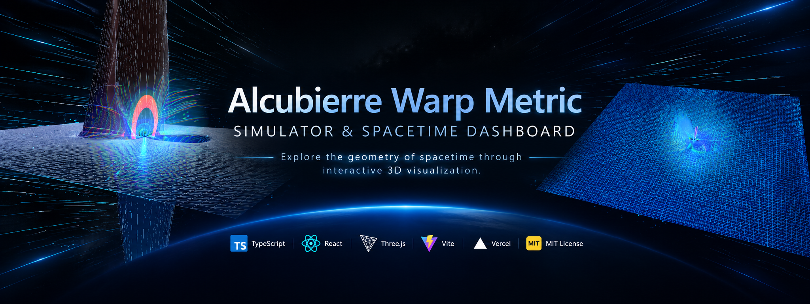

<p align="center">
  
</p>

<div align="center">

# 🚀 Alcubierre Warp Metric Simulator & Spacetime Dashboard

### An Interactive 3D Exploration of Theoretical Warp-Drive Physics

<p>
  <a href="#-español">🇪🇸 Español</a> •
  <a href="#-english">🇬🇧 English</a>
</p>

<p>
  <a href="https://github.com/Pablo-Santana-MX/alcubierre-warp-simulator">
    
  </a>
  <a href="https://alcubierre-warp-sim.vercel.app/">
    
  </a>
</p>

<p>
  
  
  
  
  
  
</p>

</div>

---

# 🇪🇸 Español

## 🌌 Descripción del proyecto

El **Alcubierre Warp Metric Simulator** es una aplicación web interactiva que explora visualmente la geometría del espacio-tiempo descrita por la métrica de deformación propuesta por el físico mexicano Miguel Alcubierre en 1994.

Desarrollado con **React, TypeScript y Three.js**, el proyecto combina visualización tridimensional acelerada por GPU, modelado matemático, audio procedural y controles interactivos para representar una burbuja de deformación espacio-temporal.

La aplicación integra conceptos de relatividad general con ingeniería de software, visualización científica y diseño de interfaces interactivas. Su objetivo es convertir un modelo físico complejo en una experiencia visual accesible, configurable y técnicamente documentada.

> **Nota científica:** este proyecto es una representación computacional interactiva de un modelo teórico. No constituye una simulación experimental validada ni demuestra la viabilidad tecnológica de un motor de curvatura.

## 🔬 Fundamento científico

En 1994, Miguel Alcubierre publicó una solución teórica a las ecuaciones de campo de Einstein que describe una geometría espacio-temporal en la que una región puede contraerse por delante de una burbuja y expandirse por detrás.

Las ecuaciones de campo de la relatividad general se expresan como:

\[
G_{\mu\nu}+\Lambda g_{\mu\nu}
=\frac{8\pi G}{c^4}T_{\mu\nu}
\]

Una forma habitual de expresar la métrica de Alcubierre es:

\[
ds^2=-c^2dt^2+
[dx-v_s(t)f(r_s)dt]^2+dy^2+dz^2
\]

Donde:

- \(ds^2\): intervalo espacio-temporal.
- \(c\): velocidad de la luz en el vacío.
- \(v_s(t)\): velocidad coordenada del centro de la burbuja.
- \(f(r_s)\): función de forma que describe la transición entre el interior y el exterior.
- \(r_s\): distancia espacial al centro de la burbuja.

La representación visual permite explorar tres características conceptuales:

1. **Contracción frontal:** modificación de la geometría delante de la burbuja.
2. **Expansión posterior:** deformación de la geometría detrás de ella.
3. **Región interior:** zona que, en el modelo ideal, puede aproximarse a una geometría localmente plana.

### ⚛️ Energía y restricciones físicas

La métrica original plantea dificultades relacionadas con las condiciones de energía de la relatividad general. En particular, algunas configuraciones de la burbuja requieren distribuciones de energía que pueden incluir densidades negativas para determinados observadores.

Estas restricciones se estudian mediante el tensor energía-momento \(T_{\mu\nu}\) y las condiciones de energía, incluida la condición débil de energía (WEC).

La densidad de energía depende de la geometría, del observador y de las convenciones de coordenadas. Por ello, cualquier representación de \(T_{00}\) en la interfaz debe interpretarse de acuerdo con las ecuaciones y aproximaciones implementadas en el simulador.

## ⚡ Características principales

- **Visualización 3D con WebGL:** representación interactiva de la burbuja y de la geometría espacial mediante Three.js.
- **Deformación en tiempo real:** actualización de la geometría a partir de los parámetros de la simulación.
- **Dashboard científico:** interfaz para explorar parámetros físicos, estados de simulación y representaciones matemáticas.
- **Sistema de partículas:** representación visual del movimiento mediante trazas estelares y efectos dependientes de la velocidad configurada.
- **Audio procedural:** síntesis de sonido mediante Web Audio API sin necesidad de archivos de audio externos.
- **Controles de orientación 3D:** navegación mediante rotación en los ejes *Roll*, *Yaw* y *Pitch*, según los controles implementados.
- **Presets teóricos:** configuraciones inspiradas en propuestas históricas de investigación sobre motores de curvatura.
- **Captura de pantalla:** posibilidad de guardar imágenes de la visualización en formato PNG, según las capacidades del navegador.
- **Interfaz bilingüe:** selección entre español e inglés para facilitar la exploración de conceptos y controles.

## 🧰 Tecnologías

| Tecnología | Función |
|---|---|
| TypeScript | Tipado estático y organización del código |
| React 19 | Componentes e interfaz de usuario |
| Three.js | Renderizado y visualización tridimensional |
| WebGL | Aceleración gráfica mediante GPU |
| Vite | Servidor de desarrollo y construcción |
| Web Audio API | Síntesis de audio procedural |
| CSS / Tailwind CSS | Estilos y composición de la interfaz, según la configuración del proyecto |
| Vercel | Plataforma prevista para el despliegue web |

## 🏗️ Arquitectura del proyecto

La estructura separa la interfaz, el núcleo matemático, el renderizado y el audio para facilitar el mantenimiento y la evolución del simulador.

```text
alcubierre-warp-simulator/
├── assets/
│   └── alcubierre-warp-banner.png
├── public/
├── index.html
├── metadata.json
├── package.json
├── tsconfig.json
├── vite.config.ts
├── vercel.json
├── README.md
├── LICENSE
└── src/
    ├── main.tsx
    ├── App.tsx
    ├── index.css
    ├── i18n/
    │   └── translations.ts
    ├── audio/
    │   └── WarpAudioEngine.ts
    ├── physics/
    │   ├── types.ts
    │   └── alcubierrePhysics.ts
    ├── webgl/
    │   ├── WarpSpacetimeScene.ts
    │   └── spacecraftModel.ts
    └── components/
        ├── SpacetimeViewport.tsx
        ├── BottomControlDock.tsx
        ├── HolographicHud.tsx
        ├── GestureController.tsx
        ├── EquationsPanel.tsx
        ├── PhysicsExplainerModal.tsx
        └── TopStatusBar.tsx
```

> **Nota:** esta estructura es una referencia basada en la organización propuesta para el proyecto. Ajusta las rutas y los archivos a los que existan realmente en el repositorio.

## 💻 Instalación y ejecución local

### Requisitos previos

- Node.js compatible con las dependencias del proyecto.
- npm.
- Navegador moderno con soporte para WebGL.

### 1. Clonar el repositorio

```bash
git clone https://github.com/YOUR_USERNAME/alcubierre-warp-simulator.git
cd alcubierre-warp-simulator
```

### 2. Instalar las dependencias

```bash
npm install
```

### 3. Iniciar el servidor de desarrollo

```bash
npm run dev
```

Abre la dirección local que indique Vite en la terminal.

### 4. Generar la versión de producción

```bash
npm run build
```

### 5. Revisar la compilación localmente

```bash
npm run preview
```

Los comandos disponibles pueden variar según los scripts definidos en `package.json`.

## 🚀 Despliegue

El proyecto puede desplegarse en Vercel conectando el repositorio de GitHub y configurando el comando de construcción y el directorio de salida de acuerdo con Vite.

Configuración habitual:

- **Build command:** `npm run build`
- **Output directory:** `dist`

Si se utiliza enrutamiento del lado del cliente, debe configurarse el fallback correspondiente. El archivo `vercel.json` debe reflejar la configuración real de la aplicación.

## 📊 Aplicaciones y competencias demostradas

Este proyecto funciona como una demostración de competencias técnicas transferibles a proyectos científicos y empresariales:

- Modelado matemático y abstracción de sistemas complejos.
- Diseño de arquitecturas modulares con TypeScript.
- Visualización interactiva de datos y modelos multidimensionales.
- Desarrollo de interfaces para explorar parámetros y resultados.
- Integración de gráficos, interacción y audio en tiempo real.
- Documentación técnica y comunicación de conceptos complejos.

Estas capacidades pueden aplicarse a simulaciones de ingeniería, visualización de datos científicos, herramientas analíticas y sistemas de exploración de escenarios.

## 📚 Referencias científicas

1. Alcubierre, M. (1994). *The warp drive: hyper-fast travel within general relativity.* Classical and Quantum Gravity, 11(5), L73–L77. [DOI: 10.1088/0264-9381/11/5/L73](https://doi.org/10.1088/0264-9381/11/5/L73)
2. Pfenning, M. J., & Ford, L. H. (1997). *The unphysical nature of "warp drive".* Classical and Quantum Gravity, 14(7), 1743–1751. [DOI: 10.1088/0264-9381/14/7/011](https://doi.org/10.1088/0264-9381/14/7/011)
3. Van Den Broeck, C. (1999). *A "warp drive" with more reasonable total energy requirements.* Classical and Quantum Gravity, 16(12), 3973–3979. [DOI: 10.1088/0264-9381/16/12/015](https://doi.org/10.1088/0264-9381/16/12/015)
4. Bobrick, A., & Martire, G. (2021). *Introducing physical warp drives.* Classical and Quantum Gravity, 38(10), 105009. [DOI: 10.1088/1361-6382/abdf6e](https://doi.org/10.1088/1361-6382/abdf6e)
5. Lentz, E. W. (2021). *Breaking the warp barrier: hyper-fast solitons in Einstein–Maxwell-plasma theory.* Classical and Quantum Gravity, 38(7), 075015. [DOI: 10.1088/1361-6382/abe692](https://doi.org/10.1088/1361-6382/abe692)

## 📄 Licencia

Este proyecto se distribuye bajo los términos de la **Licencia MIT**. Consulta el archivo `LICENSE` para conocer las condiciones de uso, modificación y distribución.

---

# 🇬🇧 English

## 🌌 Project Overview

The **Alcubierre Warp Metric Simulator** is an interactive web application exploring the spacetime geometry described by the warp-drive metric proposed by Mexican physicist Miguel Alcubierre in 1994.

Built with **React, TypeScript, and Three.js**, the project combines GPU-accelerated 3D visualization, mathematical modeling, procedural audio, and interactive controls to represent a spacetime-warp bubble.

It brings together concepts from general relativity, software engineering, scientific visualization, and interactive interface design. Its goal is to transform a complex theoretical model into an accessible, configurable, and technically documented visual experience.

> **Scientific note:** this project is an interactive computational representation of a theoretical model. It is not a validated experimental simulation and does not demonstrate the technological feasibility of a warp drive.

## 🔬 Scientific Foundations

In 1994, Miguel Alcubierre published a theoretical solution to Einstein's field equations describing a spacetime geometry in which a region can contract ahead of a bubble and expand behind it.

Einstein's field equations can be written as:

\[
G_{\mu\nu}+\Lambda g_{\mu\nu}
=\frac{8\pi G}{c^4}T_{\mu\nu}
\]

A commonly used form of the Alcubierre metric is:

\[
ds^2=-c^2dt^2+
[dx-v_s(t)f(r_s)dt]^2+dy^2+dz^2
\]

Where:

- \(ds^2\): spacetime interval.
- \(c\): speed of light in vacuum.
- \(v_s(t)\): coordinate velocity of the bubble's center.
- \(f(r_s)\): shape function describing the transition between the bubble's interior and exterior.
- \(r_s\): spatial distance from the bubble's center.

The visualization explores three conceptual features:

1. **Forward contraction:** changes in the geometry ahead of the bubble.
2. **Rear expansion:** geometric deformation behind the bubble.
3. **Interior region:** an area that can approximate locally flat geometry in the idealized model.

### ⚛️ Energy Conditions and Physical Constraints

The original metric raises important questions about the energy conditions of general relativity. In particular, the energy distributions required for certain bubble configurations can include negative energy densities for some observers.

These constraints can be investigated through the stress-energy tensor \(T_{\mu\nu}\) and energy conditions, including the Weak Energy Condition (WEC).

The energy density depends on the geometry, observer frame, and coordinate conventions. Any representation of \(T_{00}\) in the interface should therefore be interpreted according to the equations and approximations implemented by the simulator.

## ⚡ Key Features

- **WebGL-powered 3D visualization:** interactive rendering of the bubble and spatial geometry with Three.js.
- **Real-time deformation:** geometry updates based on simulation parameters.
- **Scientific dashboard:** an interface for exploring physical parameters, simulation states, and mathematical representations.
- **Particle system:** visual representation of motion through stellar streaks and effects driven by configured velocity.
- **Procedural audio:** sound synthesis through the Web Audio API without external audio files.
- **3D orientation controls:** navigation through *Roll*, *Yaw*, and *Pitch*, depending on the implemented controls.
- **Theoretical presets:** configurations inspired by historical research proposals for warp drives.
- **Screenshot capture:** the ability to save visualization snapshots as PNG images, subject to browser capabilities.
- **Bilingual interface:** English and Spanish localization for exploring concepts and controls.

## 🧰 Technology Stack

| Technology | Purpose |
|---|---|
| TypeScript | Static typing and code organization |
| React 19 | UI components and application interface |
| Three.js | 3D rendering and visualization |
| WebGL | GPU-accelerated graphics |
| Vite | Development server and build tooling |
| Web Audio API | Procedural audio synthesis |
| CSS / Tailwind CSS | Interface styling and composition, depending on project configuration |
| Vercel | Intended web deployment platform |

## 🏗️ Project Architecture

The codebase separates the user interface, mathematical core, rendering engine, and audio system to support maintainability and future development.

```text
alcubierre-warp-simulator/
├── assets/
│   └── alcubierre-warp-banner.png
├── public/
├── index.html
├── metadata.json
├── package.json
├── tsconfig.json
├── vite.config.ts
├── vercel.json
├── README.md
├── LICENSE
└── src/
    ├── main.tsx
    ├── App.tsx
    ├── index.css
    ├── i18n/
    │   └── translations.ts
    ├── audio/
    │   └── WarpAudioEngine.ts
    ├── physics/
    │   ├── types.ts
    │   └── alcubierrePhysics.ts
    ├── webgl/
    │   ├── WarpSpacetimeScene.ts
    │   └── spacecraftModel.ts
    └── components/
        ├── SpacetimeViewport.tsx
        ├── BottomControlDock.tsx
        ├── HolographicHud.tsx
        ├── GestureController.tsx
        ├── EquationsPanel.tsx
        ├── PhysicsExplainerModal.tsx
        └── TopStatusBar.tsx
```

> **Note:** this tree is a reference structure based on the proposed project organization. Update file paths and filenames to match the actual repository.

## 💻 Installation and Local Development

### Prerequisites

- Node.js compatible with the project's dependencies.
- npm.
- A modern browser with WebGL support.

### 1. Clone the repository

```bash
git clone https://github.com/YOUR_USERNAME/alcubierre-warp-simulator.git
cd alcubierre-warp-simulator
```

### 2. Install dependencies

```bash
npm install
```

### 3. Start the development server

```bash
npm run dev
```

Open the local URL displayed in the Vite terminal output.

### 4. Build for production

```bash
npm run build
```

### 5. Preview the production build

```bash
npm run preview
```

Available commands may differ depending on the scripts defined in `package.json`.

## 🚀 Deployment

The project can be deployed to Vercel by connecting the GitHub repository and configuring the build command and output directory for Vite.

Typical configuration:

- **Build command:** `npm run build`
- **Output directory:** `dist`

If client-side routing is enabled, configure the appropriate fallback behavior. The `vercel.json` file should match the application's actual routing configuration.

## 📊 Applications and Demonstrated Skills

This project demonstrates technical capabilities that can transfer to scientific and business-oriented software development:

- Mathematical modeling and abstraction of complex systems.
- Modular software architecture with TypeScript.
- Interactive visualization of multidimensional data and models.
- Interface design for exploring parameters and simulation outputs.
- Integration of graphics, interaction, and audio in real time.
- Technical documentation and communication of complex concepts.

These capabilities can be applied to engineering simulations, scientific data visualization, analytical tools, and scenario-exploration systems.

## 📚 Scientific References

1. Alcubierre, M. (1994). *The warp drive: hyper-fast travel within general relativity.* Classical and Quantum Gravity, 11(5), L73–L77. [DOI: 10.1088/0264-9381/11/5/L73](https://doi.org/10.1088/0264-9381/11/5/L73)
2. Pfenning, M. J., & Ford, L. H. (1997). *The unphysical nature of "warp drive".* Classical and Quantum Gravity, 14(7), 1743–1751. [DOI: 10.1088/0264-9381/14/7/011](https://doi.org/10.1088/0264-9381/14/7/011)
3. Van Den Broeck, C. (1999). *A "warp drive" with more reasonable total energy requirements.* Classical and Quantum Gravity, 16(12), 3973–3979. [DOI: 10.1088/0264-9381/16/12/015](https://doi.org/10.1088/0264-9381/16/12/015)
4. Bobrick, A., & Martire, G. (2021). *Introducing physical warp drives.* Classical and Quantum Gravity, 38(10), 105009. [DOI: 10.1088/1361-6382/abdf6e](https://doi.org/10.1088/1361-6382/abdf6e)
5. Lentz, E. W. (2021). *Breaking the warp barrier: hyper-fast solitons in Einstein–Maxwell-plasma theory.* Classical and Quantum Gravity, 38(7), 075015. [DOI: 10.1088/1361-6382/abe692](https://doi.org/10.1088/1361-6382/abe692)

## 📄 License

This project is distributed under the terms of the **MIT License**. Refer to the `LICENSE` file for terms covering use, modification, and distribution.

---

<p align="center">
  <sub>Built for scientific exploration, interactive visualization, and computational thinking.</sub>
</p>
